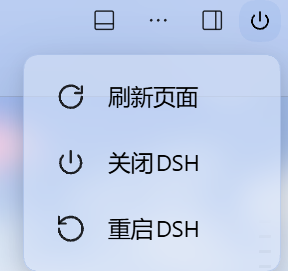
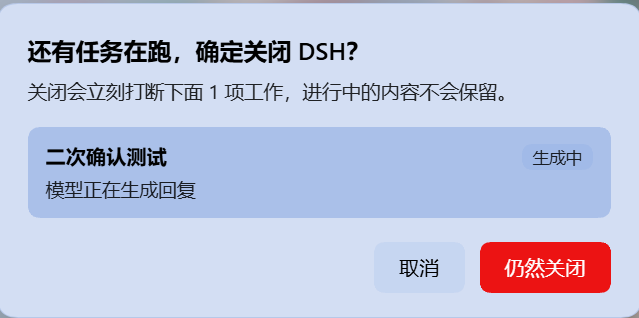
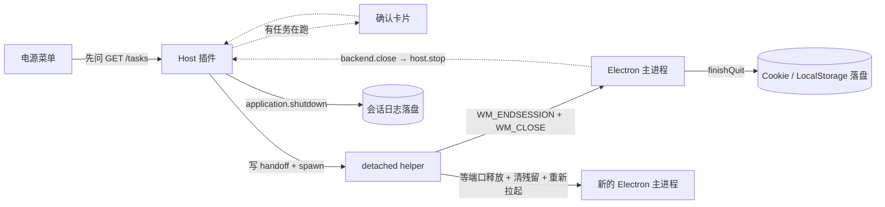

# dsh-power-menu

给 DeepSeek Harness 桌面版加一个右上角电源按钮：点开只有 **关闭DSH** 和 **重启DSH** 两项，省得每次改完插件/配置还要去系统托盘里翻「退出」。退出走应用自己的关停流程，不是从外部硬杀；有任务在跑还会先拦一下。

> **仅 Windows**（macOS / Linux 用不了，原因见「兼容性」）· 只支持 DSH Desktop · 纯本地 · 除系统自带 PowerShell 外无外部依赖 · MIT
>
> ⭐ 如果这个小工具帮你省了点时间，欢迎点个 **Star** 支持一下，感谢～



有任务在跑时，点下去之前会先拦一下：



## 为什么做这个

DSH Desktop 关窗口只是收进托盘，真正退出或重启要走托盘菜单；而改插件、改配置之后又经常需要重启一次。这个插件把这两步搬到会话标题栏右上角：一个电源键，两项操作，点完就走。

顺带把「退出」这件事做正了：不是从外面 taskkill，而是请应用自己走完关停流程，Cookie 和会话日志都能正常落盘。

## 功能

- **右上角电源按钮**：位于会话标题栏图标行最右侧，顺序为「布局 / 侧栏 / 电源」。
- **空会话也显示**：欢迎页和对话内使用同一个挂载位置，透明无底色，不会破坏主题，也不会出现两个按钮。
- **Windows 电源菜单风格**：白色圆角卡片、悬浮阴影、左侧线性图标 + 右侧文本，只有两项，不塞多余入口。
- **关闭DSH**：让整个桌面应用走它自己的退出链（`before-quit` → Host shutdown），Cookie / LocalStorage 正常落盘，不重新启动。
- **重启DSH**：同样先优雅退出，等旧端口释放、按 exe 扫掉残留进程后再用原可执行文件拉起，窗口自动回来。
- **有任务才确认**：点之前先问一次 `/tasks`。有会话正在生成、有排队消息或有后台任务在跑时，弹出卡片列出会被打断的会话与任务，确认才动手；空闲时直接执行，不多问。
- **键盘可用**：`↑` / `↓` / `Home` / `End` 在两项间移动，`Enter` / 空格执行，`Esc` 关闭，点菜单外部也能关。
- **执行反馈**：点击后整页盖一层半透明遮罩，显示「正在关闭DSH…」/「正在重启DSH…」。
- **纯本地**：没有第三方依赖、没有遥测；接口只监听本机回环地址，并做同源校验。

## 安装

> ⚠️ **只能装在 Windows 版的 DSH Desktop 上。** 非 Windows 系统里按钮能出现，但关闭和重启都执行不了——接口会直接返回 409。

> **重要**：装完插件后，必须再运行一次 `enable.ps1`（或直接用下面的 `install.ps1`），把 `dsh-power-menu` 补进 profile 的 `dsh.profile.bundles`，然后重启 DSH。少了这一步，按钮会 404——这是 DSH 插件管理器只写 `dependencies`、不写 bundles 的已知行为，不是插件本身的问题。

### 方式 A：一键脚本（推荐）

从仓库下载 ZIP 或 `git clone` 后，在目录里运行：

```powershell
powershell -ExecutionPolicy Bypass -File .\install.ps1
```

脚本会：清理旧的 link/junction 残留（避免 pnpm 的 `ERR_PNPM_EPERM`，界面上表现为「没有写入权限」）→ 用 DSH 自带 CLI 安装 → 补齐 `dsh.profile.bundles` → 提示重启。

GitHub 直连慢或不通时，改用镜像：

```powershell
powershell -ExecutionPolicy Bypass -File .\install.ps1 -Mirror
```

> **机器上没有 git 也能装**：`install.ps1` 会先检查 `git`；没有就自动从 GitHub Release 下载 `dsh-power-menu-0.1.21.tgz`，再用本地文件安装，全程不调用 git（这正是 `ERR_PNPM_GIT_RESOLVE_FAILED` 的解法）。直连下不动会自动改走 gh-proxy 镜像；也可以用 `-TgzPath` 指定已经拷到本机的安装包，完全离线安装。
>
> 脚本默认**不改用户 PATH**；需要让插件管理器以后也能解析便携 git 时，加 `-Github -WritePath`。下载 tgz 会优先用 Release 的 `SHA256SUMS.txt` 校验，离线包可用 `-Sha256 <hash>` 手动校验。

### 方式 B：通过 DSH 插件管理器

1. 打开 DSH Desktop 的 **插件 / 插件市场**。
2. 选择 **添加插件**，输入：

   ```text
   github:xichen-62/dsh-power-menu
   ```

3. 安装完成后，下载/克隆本仓库，运行 `enable.ps1` 补一次 bundles（这一步不能省）：

   ```powershell
   powershell -ExecutionPolicy Bypass -File .\enable.ps1
   ```

4. 重启 DSH，并在 **插件市场 → 已安装** 里确认 `dsh-power-menu` 处于「启用中」。

> 如果装完点按钮报 `HTTP 404`，说明插件只进了 `dependencies`、没进 `dsh.profile.bundles`，宿主半没加载。运行仓库里的 `enable.ps1`（右键使用 PowerShell 运行），它会先备份 profile，再把 `dsh-power-menu` 补进 `dsh.profile.bundles`；然后重启 DSH。

### 方式 C：命令行安装

```bash
dsh plugin --profile desktop add github:xichen-62/dsh-power-menu
powershell -ExecutionPolicy Bypass -File .\enable.ps1
```

> `dsh` 是 DSH 自带的 CLI；如果 PATH 里没有，请用 DSH 安装目录里的 `dsh` / `dsh.cmd`。

### 方式 D：本地开发安装

```bash
git clone https://github.com/xichen-62/dsh-power-menu.git
```

把插件链接进 desktop profile：

```powershell
# Windows PowerShell
$profileDir = "$env:USERPROFILE\.dsh\profiles\desktop"
New-Item -ItemType Junction `
  -Path "$profileDir\node_modules\dsh-power-menu" `
  -Target "<你 clone 下来的目录>"
```

然后在 `$profileDir\package.json` 里：

- `dependencies` 增加 `"dsh-power-menu": "link:<你 clone 下来的目录>"`
- `dsh.profile.bundles` 增加 `"dsh-power-menu"`

重启 DSH 生效。这个插件没有构建步骤，改完 `lib/` 里的文件重启即可。

> **注意**：`link:` 安装会在 `node_modules` 里创建 junction。之后如果改用插件管理器（`github:` 安装）升级同一个包，pnpm 的临时目录 rename 会撞上这个 junction，报 `ERR_PNPM_EPERM`，界面上显示「没有写入权限」。遇到时先删链接再重装：`cmd /c rmdir "$profileDir\node_modules\dsh-power-menu"`（只删链接，不动 clone 的源码）。

## 使用

1. 在会话标题栏右上角点电源图标。
2. 选择 **关闭DSH** 或 **重启DSH**。
3. 等待遮罩出现：关闭会退出应用；重启会在几秒后把窗口拉回来。

| 动作 | 结果 | 需要手动重开？ |
| --- | --- | --- |
| 关闭DSH | 结束整个桌面应用，不重新启动 | 是 |
| 重启DSH | 结束应用 → 等端口释放 → 重新拉起 | 否，窗口自动回来 |

> **注意**：空闲时点击即执行；只要有会话正在生成、有排队消息或有后台任务在跑，就会先弹出确认卡片，把要被打断的会话、任务和已运行时长列出来，确认后才动手。确认之后，两个动作都会中断正在进行的工作，请在点之前保存手头的事情。

## 工作原理

桌面版的进程树大致是：

```text
Electron 主进程
└── Host 子进程（dsh-desktop-host，ELECTRON_RUN_AS_NODE=1）
    └── 本插件
```

插件跑在 Host 里，不能直接调用 Electron 的 `app.quit()` / `app.relaunch()`，桌面版也没有给插件任何协作退出的 IPC。所以 Host 只负责“交接”，真正的进程切换交给一个分离的 helper；helper 也不再硬杀，而是先请主进程走它自己的退出链：



具体步骤：

1. 点按钮前，前端先请求 `/tasks`。有任务在跑就先弹确认卡片，确认后才发 POST。
2. Host 把交接信息写到 `%USERPROFILE%\.dsh\dsh-power-menu\`，用 `process.execPath` + `ELECTRON_RUN_AS_NODE=1` 启动 `lib/helper.cjs`。
3. helper 等 1.2 秒，让 HTTP 应答先到浏览器。
4. helper 定位主窗口（`Chrome_WidgetWin_1`，属主是主进程），先 `PostMessage(WM_ENDSESSION, wParam=1)`，再 `PostMessage(WM_CLOSE)`。桌面壳收到后置 `sessionEnding = true`：窗口关闭不再被拦截，`before-quit` 跳过任务确认，直接跑完 `finishQuit → stopOperationReports → backend.close() → host.stop() → app.quit()`，Cookie 和 LocalStorage 正常落盘。
5. Host 收到 `shutdown` 后走自己的 `application.shutdown`，把会话日志正常落盘；Host 自身还有 5 秒退出兜底。
6. 窗口 15 秒还没退（找不到窗口、消息被拒或壳版本变了）才回落到 `taskkill /PID <主进程> /F`，**刻意不带 `/T`**。
7. 重启模式下，helper 等旧监听端口释放，再按 `ExecutablePath` 全量枚举同一 exe 的残留进程（三轮重试 + 复查 sweep，排除自己和宿主），确认干净后用原可执行文件重新拉起，并确认新进程有真实窗口；失败重试三次，仍失败弹窗提示手动打开。
8. 关闭模式下不拉起，等 Host 自己退出。

### 接口

Host 半注册四个仅限本机回环的接口：

```text
POST /api/dsh-power-menu/shutdown
POST /api/dsh-power-menu/restart
GET  /api/dsh-power-menu/health
GET  /api/dsh-power-menu/tasks
```

`/tasks` 返回当前会被打断的工作：每个活动会话的标题、是否正在生成、排队消息数，以及它名下所有 `running` / `stopping` 的后台任务（含 label、进度、开始时间）；没有归属的活动任务单独列在 `ownerless` 下。空闲时 `active` 为 `false`。

## 安全

- 四个接口只接受回环地址（`127.0.0.1` / `::1`），校验 `Host` 必须是本机，拒绝 `sec-fetch-site: cross-site`，带 `Origin` 时必须与本机同源。
- 返回 409 有两种情况：当前不是桌面版（`dsh web`），或者上一次关停还没走完。两种都不会重复触发。
- 没有鉴权令牌的第三方网页无法跨站触发关机/重启。
- 只支持桌面版；`dsh web` 下接口返回 409，不会去杀别的进程。
- 不收集任何数据，不联网，不写注册表；日志只写在本地 `%USERPROFILE%\.dsh\dsh-power-menu\`。

## 兼容性

- **系统**：Windows 10 / 11。优雅退出这一段依赖 Windows 的窗口消息（`WM_ENDSESSION` / `WM_CLOSE`）和 `taskkill` 兜底。
- **为什么没有 macOS / Linux 版**：不是「还没做」。DSH 在 Windows 上是通过主窗口的 `session-end` 事件触发退出链的，非 Windows 走的是 `powerMonitor.on('shutdown')`——那是系统级事件，外部插件没法模拟，也就没有「先请应用自己退」这条路可走。
- **DSH**：在 **DSH Desktop 0.2.2-rc.3** 上实测通过（2026-11-15），关闭 2.9 秒、重启 9.6 秒，全程没有 `taskkill`。0.2.1 的旧行为（强杀主进程）也仍然可用，但会退回硬退出的路径。
- **Node**：跟随 DSH 自带的 Node（22+），无需单独安装。

## 开发

```text
dsh-power-menu/
├── lib/
│   ├── index.js        Host 半：四个回环接口 + 交接调度
│   ├── client.js       浏览器半：window.__ModuleLoader__ bundle
│   └── helper.cjs      分离的交接 helper
├── cordis.patch.yml    bundle 插入层
├── package.json
├── docs/screenshot.png
└── README.md
```

- 客户端 bundle 不是普通 ESM，必须用 `window.__ModuleLoader__.load({ id, factory })` 格式；`dsh.client.inject` 声明 `@deepseek-ai/dsh-client-ui-slots`。
- 没有构建步骤，也没有运行时 npm 依赖。
- 提交前跑一次静态检查：

  ```bash
  npm run check
  ```

- 本地调试日志：`%USERPROFILE%\.dsh\dsh-power-menu\power-menu.log` 和 `helper-*.log`。

## 常见问题

**按钮没出现？**
确认插件处于「启用中」，并重启过一次 DSH；按钮只出现在有会话标题栏的页面。

**插件卡片上没显示介绍？**
本地开发（link 安装）的插件，卡片不读 `package.json` 的 `description`，需要在卡片上点「添加备注」自己填。这是 DSH 插件管理器的行为，不是插件的问题。

**重启后端口变了？**
正常。DSH Desktop 每次启动用随机端口（`--port 0`），插件只负责拉起新实例，不假设端口不变。

**DSH 装在中文路径 / 用户名含中文能用吗？**
可以。插件不拼 `cmd` 字符串：启动用 `spawn(exe, [], { cwd })`，路径作为单个 argv 交给 Node 的 Unicode API；交接 JSON 和日志按 UTF-8 读写；helper 自带 `--pathtest`，会在“中文 + 空格”的临时目录里实测 UTF-8 读写和从中文路径启动 exe。安装脚本也按 UTF-8 BOM 保存。

**点了没反应？**
看 `%USERPROFILE%\.dsh\dsh-power-menu\` 下的日志；`dsh web` 环境会返回 409（仅支持桌面版）。

**为什么按钮不挂真实 slot？**
DSH 的 `conversation.session.header.corner` 是单占用槽，已经被侧栏开关占用；`conversation.session.header.utilities` 会排在侧栏左侧；`sidebar.footer.action` 在左下角。要在不修改 DSH 的前提下保持右上角，只能把按钮挂进 `headerCorner` 的 DOM。代价是上游改头部结构时可能失效；插件用 `MutationObserver` 跟随，不再 500ms 轮询。

**关闭/重启会跳过 profile 收尾吗？**
0.1.19 起不再硬杀了。helper 会给主窗口发 `WM_ENDSESSION` + `WM_CLOSE`，让桌面壳自己走完 `before-quit → finishQuit → backend.close() → host.stop() → app.quit()`，Cookie / LocalStorage 正常落盘，Host 也自己 flush 会话日志。剩下的是插件自己 spawn 的子进程（computer-use、上下文插件、子 agent 之类）——它们不归 DSH 的关停流程管，主进程退完还可能留着，所以重启前会按 `ExecutablePath` 把同一 exe 的进程全量枚举一遍兜底。实测关闭 2.9 秒、重启 9.6 秒，全程没有强杀；只有兜底那一步会用到 `taskkill`，日志里会明确写出来。

**装完点按钮报 `HTTP 404`？**
说明宿主半没加载：插件只在 `dependencies` 里，不在 `dsh.profile.bundles` 里。运行仓库里的 `enable.ps1`，或手动把 `dsh-power-menu` 加进 profile 的 `dsh.profile.bundles`，再重启 DSH。0.1.9 起不再依赖 `postinstall`——pnpm 11 默认会拦截依赖的生命周期脚本，装不上钩子。

**插件安装失败，提示「没有写入权限，无法安装」？**
多半是之前用 `link:` 装过（`node_modules\dsh-power-menu` 是 junction），pnpm 升级时 rename 覆盖不了它，报 `ERR_PNPM_EPERM`，被安装器误读成权限问题。先删链接再重装：

```powershell
cmd /c rmdir "$env:USERPROFILE\.dsh\profiles\desktop\node_modules\dsh-power-menu"
```

或者直接运行 `install.ps1`，它会自动处理这一步。

**GitHub 直连很慢 / 报网络错误？**
用 `install.ps1 -Mirror`，或把安装来源换成 `https://gh-proxy.com/https://github.com/xichen-62/dsh-power-menu.git`。插件本身不联网，这只是下载阶段的网络问题。

**装的时候报 `ERR_PNPM_GIT_RESOLVE_FAILED` / 这台电脑没装 git？**
这不是插件的问题：`github:` 安装是 pnpm 的 git 依赖，pnpm 必须先调起系统里的 `git` 做 `ls-remote`，没有 git 就直接失败（界面上的 `added 0` 说明一个文件都没下载）。两条路：

- 跑 `install.ps1`：检测到没有 git 会自动改用 Release 里的 `.tgz`，不碰 git。
- 想保留 `github:` spec：跑 `install.ps1 -Github`，它会下载便携版 git；需要写进用户 PATH 时再加 `-WritePath`，之后 `github:` 和仓库 URL 都能装（重启 DSH 后插件管理器也生效）。
- 或者直接装 tarball（pnpm 走 HTTP 下载后本地解包）：

  ```powershell
  dsh plugin --profile desktop add https://github.com/xichen-62/dsh-power-menu/releases/latest/download/dsh-power-menu-0.1.21.tgz
  ```

  GitHub 慢的话，在前面加 `https://gh-proxy.com/` 走镜像；也可以把 tgz 下载到本机后用 `dsh plugin --profile desktop add file:<路径>` 安装。

## 卸载

- 插件管理器里移除 `dsh-power-menu`，或者从 profile 的 `dependencies` / `dsh.profile.bundles` 里删掉，再删掉 `node_modules` 里的链接。
- 可选：删除 `%USERPROFILE%\.dsh\dsh-power-menu\` 下的日志与交接文件。
- 重启 DSH 生效。

## 更新日志

见 [CHANGELOG.md](CHANGELOG.md)。

## 许可证

[MIT](LICENSE) © 2026 xichen-62

## 致谢

- 分离 helper 做进程交接、只结束主进程让 Host 优雅退出的思路，参考了 [dsh-desktop-restart](https://github.com/luoshuizhiwei/dsh-desktop-restart)（MIT）。本项目的实现是独立编写的。
- 菜单样式参考 Windows 电源菜单；图标为内联 SVG，无第三方图标库。

---

## English

A small DSH Desktop plugin that adds a power button to the top-right of the session header. It opens a Windows-style menu with exactly two actions:

- **关闭DSH** — quit the whole desktop app (no relaunch).
- **重启DSH** — quit and relaunch the app, so the window comes back automatically.

Both actions go through the app's own shutdown chain instead of a hard kill, and a confirmation card lists any running work before the transition.

**Windows only.** It drives the Windows `WM_ENDSESSION` window message; on macOS/Linux the equivalent is a system-level `powerMonitor` event that an external plugin cannot simulate, so there is no port to be made here. DSH Desktop only. No telemetry, no third-party dependencies — it posts the window message through the bundled PowerShell. The four HTTP routes are loopback-only and same-origin fenced.

Install from GitHub:

```bash
dsh plugin --profile desktop add github:xichen-62/dsh-power-menu
```

or add `github:xichen-62/dsh-power-menu` in the DSH plugin manager, then run `enable.ps1` and restart DSH. The one-click `install.ps1` handles both the install and the `dsh.profile.bundles` registration, and cleans up a stale `link:` junction that would otherwise make pnpm fail with `ERR_PNPM_EPERM` ("No write permission; the plugin cannot be installed").

**No git on the machine?** The `github:` spec is a pnpm *git* dependency, so pnpm must spawn `git` and fails with `ERR_PNPM_GIT_RESOLVE_FAILED` when it is missing. `install.ps1` detects that and installs the `.tgz` attached to the GitHub Release instead (no git involved); the tarball URL can also be passed to `dsh plugin add` directly.

If this saves you some time, a ⭐ **star** is much appreciated. Thanks!

MIT licensed.
